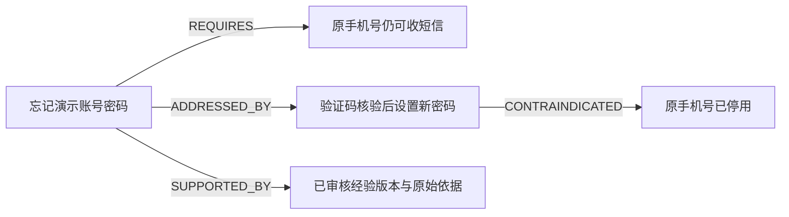

# 一线经验知识图谱与Agent检索增强：实施计划

日期：2026-10-22。依据作者最新要求收敛范围。本轮以AI生成的合成一线回复、异常案例和结果反馈作为演示输入，不开展联邦学习或模型参数训练。状态：G0素材、G1记录、G2经验卡、G3真实构图/生命周期及G4 Agent图谱接入已完成；G5工程对照及真实生成已执行，人工语义复核与完整真实Agent自主选图工具验证待完成。G1–G4于2026-10-23、G5于2026-10-27完成相应执行，CI以开发分支Actions为准，见文末进展。

本文件替代同日《管理员减负与经验学习Agent：研究核查与修改计划》的执行顺序。旧文件保留研究核查和长期设想，自动分配、通用动作策略引擎及多租户均移出本轮必做范围。维护副本为`D:\SmartTicket-AI\.workspaces\review`，源码基线为`b26093b`。

## 1. 这次要真正实现什么

目标闭环：AI合成一线回复/处理过程→保存到真实数据库→结构化经验与去重→审核版本→构建真实图关系和向量索引→Agent调用图谱检索工具→带来源和适用条件回答→记录反馈与修订→撤回后不可检索。

“学习知识图谱”具体指：模型在每次请求中检索最新经验、读取关系和证据，再组织回答。新增知识后不需要重训DeepSeek。经验内容不会自动授予角色或写库权限；现有指派确认、对象权限、版本保护继续有效。

演示数据可以由AI生成，后端入库、去重、图构建、查询、版本切换和权限检查必须真实执行。预设的合成效果反馈和实际运行结果分开，不能把生成的“成功”文字当作程序验收通过。

## 2. 为什么采用这条路线

[KCS的复用改进实践](https://library.serviceinnovation.org/KCS/KCS_v6/KCS_v6_Practices_Guide/030/030/040/020)支持将处理经验沉淀并在复用时修正；[知识角色与发布权限](https://library.serviceinnovation.org/KCS/KCS_v6/KCS_v6_Practices_Guide/030/040/030/020)也说明贡献者与发布者可以分工。

[GraphRAG原论文](https://arxiv.org/abs/2404.16130)提供通过实体和关系组织证据的研究依据，但重点包括大语料全局总结，不能据此保证本项目FAQ效果提升。首版采用现有PG中的轻量关系表，不引入完整GraphRAG框架或新图数据库；[官方索引说明](https://microsoft.github.io/graphrag/index/methods/)也展示了模型提取成本与图质量之间的取舍。

[OPA的工具调用说明](https://www.openpolicyagent.org/docs/agent-tool-calling)明确区分模型提出调用与外围程序执行。该边界在本轮保持：模型用图谱辅助判断，真实工具、权限和状态仍由Java代码控制。

以上是方法参考，不是效果承诺。首批合成素材只用于开发、演示和回归，不能称为真实客户语料或独立盲测。

## 3. 演示素材与来源标记

素材放在`07_测试与质量/07_经验图谱合成演示数据/`，包含合成员工身份引用、一线回复、操作过程、成功/失败/待核实反馈、精确重复和近似但条件不同的案例。无真实客户数据、API Key或实际账号ID。

每条素材区分三层：

| 层次 | 内容 | 可否当作运行证据 |
|---|---|---|
| 合成业务记录 | AI编写的客户问题、员工回复、模拟反馈 | 否，只是测试输入 |
| 预期行为 | 开发者预先标注的应答、去重、人工处理等要求 | 否，是待验证的开发契约 |
| actual_runtime | 真正运行后生成的工单ID、候选版本、来源、工具调用与断言结果 | 执行后才可作为相应工程证据；初始为空 |

沿用已有事实时标明对应FAQ或架构文档。模拟短信等业务规则必须保留“演示平台规则，非SmartTicket已实现业务”的范围。未知结论、失败尝试和后续纠正均保留，不能把错误回复直接导入为成功知识。

## 4. 数据与知识图谱设计

复用`ticket_resolution`、`knowledge_candidate`、知识任务/Outbox、审核和撤回链路，不再新建另一套发布状态机。增加：

| 位置 | 拟议内容 | 说明 |
|---|---|---|
| MySQL ticket_interaction | 一线员工回复、步骤、版本、引用和来源 | 追加式记录，身份取自服务端；只允许访问相应工单 |
| MySQL experience_feedback | 采用、有效、失败、纠正或待核实 | 模拟反馈标来源，实际使用反馈单独记录 |
| MySQL knowledge_experience_version | 条件、症状、步骤、结果、反例与内容哈希 | 绑定已有candidateId＋revision，避免结构与文本串版 |
| PG experience_node | 类型化概念节点 | 类型＋规范化key＋scope唯一；不建包含客户隐私的跨案例共享实体 |
| PG experience_edge | 概念间的关系 | 如REQUIRES、ADDRESSED_BY、HAS_OUTCOME |
| PG experience_edge_evidence | 每条关系的来源、候选版本、证据及提取规则版本 | 同一关系可有多个来源；撤回一个来源不误删其他支持证据 |

第一版节点类型：问题、症状、适用条件、处理步骤、结果。关系包括HAS_SYMPTOM、REQUIRES、ADDRESSED_BY、HAS_OUTCOME、CONTRAINDICATED；推测根因单独标记，不直接作为已确认因果关系。

示例关系：



该图表示条件与指引，不代表本项目提供真实短信重置接口。每条关系须能追溯来源；节点、关系、文本、发布状态的版本共同校验。

## 5. 采集、结构化、去重和发布

1. **采集**：新增员工记录接口及演示导入适配器。导入器在隔离环境创建真实合成工单，使用本次随机测试身份；素材逻辑标识映射到运行ID，不把旧测试账号硬编码成生产账号。
2. **结构化**：先用已提供的结构字段、模板和受约束规则构造经验卡。AI离线生成的字段仍需schema校验；后续可选模型辅助提炼，但仅生成候选，不直接认可为事实。
3. **去重**：规范化后计算内容哈希处理精确重复；规范化不能丢掉否定词、数值、版本或前提。近似匹配只产生待核对关系，不能凭相似度直接合并。精确复用已有审核版本减少重复审批，新条件进入差异审核。
4. **审核**：保留现有ADMIN审核接口。首批演示可用明确标记的测试管理员经真实HTTP完成审核；这只是合成工作流验证，不是作者/专家替真实客户资料签字。进一步拆分知识审核角色属于后续增强。
5. **发布**：复用INDEX任务，PG同一事务写入该版文本、节点/关系证据和发布目录；全部完成才回写MySQL索引回执。构图不调用任意模型生成代码，不执行其SQL或Shell。
6. **反馈与修订**：新反馈追加关联原经验版本；修订走新revision，不覆盖旧证据。未知效果保留UNVERIFIED；知识量增加不自动代表质量提高。

默认继续限制SHARED_DEMO，不接入真实私有客户聊天，不新增外发资料范围。实施前基线MySQL迁移至05、PG至02，新增编号迁移，不修改已经运行的历史SQL。

## 6. Agent如何检索和使用图谱

新增只读工具`searchExperienceGraph(query)`，可返回：经验ID、candidateId/revision、适用条件、步骤、禁止条件、有限关系路径及真实sourceId。普通FAQ保留`searchKnowledge`，不强制每次额外调用两个检索工具。

后端检索顺序：

```text
身份和作用范围检查
→ 现有向量＋关键词检索定位经验
→ 有来源的关系扩展（最多2跳，并限制节点、边数和总Token）
→ 校验MySQL候选状态、indexedRevision、PG发布版本
→ 返回证据、条件、步骤和反例
→ 模型生成建议或说明资料不足
```

不是模型看到图谱后自己连接数据库遍历。Java图检索服务执行查询，工具结果通过现有Agent循环回传模型。

当前`AgentToolContext`和`AgentService`只把`searchKnowledge`识别为知识工具。新增图谱工具必须同步接入来源收集、scope、裁剪、去重、searched标记和最终答案校验，不能仅把工具加进definitions。图节点ID不能冒充可引用sourceId，只有工具实际返回的有效来源可被最终回答引用。

图检索延续当前预算和时限，不擅自增加模型调用上限。资料无依据、条件不满足或图不可用时，明确返回原因并可降级文本建议；不声称已经排除故障、发送客户消息或修改业务状态。

## 7. 撤回、版本和能力边界

知识撤回先在MySQL阻止新请求使用，再由DELETE任务清理PG切片与该版本关系证据，保留必要墓碑，抵挡迟到的旧发布。共享概念可以保留，但不得沿撤回来源向用户返回其事实或路径。

PG已写成功而MySQL回执失败时，按候选版本、结构/文本哈希及模型核对后补回执；不重复生成嵌入或累加重复关系。检索与回答时仍显示适用范围；已返回的历史回答不追溯撤销。

本轮不增加自动指派、自动解决、自动关单或新高权限写工具。Agent学到方法后，可以在合法范围内直接返回更完整的建议，已审核知识重复复用不逐次请示管理员；需要写入的业务操作仍按现有权限与确认接口执行。新异常可转人工，但旧异常若越权或前提变化也不能自行处理。

## 8. 实施顺序、代码触点与工时

| 阶段 | 工作 | 主要触点 | 估算 |
|---|---|---|---|
| G0 素材与基线 | 固定合成案例、预期行为、来源与运行空字段，保存当前文档检查点 | 本文件、合成素材与manifest；不改运行逻辑 | 2–3小时 |
| G1 一线记录 | 增量DDL、员工记录/反馈接口、隔离演示导入 | 新增Interaction服务/接口，TicketService与对象权限 | 5–8小时 |
| G2 经验结构与去重 | 固定schema、精确重复、条件差异、来源与版本 | ResolutionRecorder、KnowledgeWorkflowRepository、经验服务 | 6–10小时 |
| G3 构图和生命周期 | PG节点/边/证据、INDEX/DELETE扩展、失败补偿 | KnowledgeWorker、KnowledgeVectorRepository、KnowledgeVisibility | 8–12小时 |
| G4 Agent接入 | 图检索服务与只读工具、来源裁剪、提示与最终输出校验 | AgentTools、AgentService、AgentToolContext、AgentAnswer | 5–8小时 |
| G5 验证与演示 | 真实HTTP/数据库/本地BGE、模型替身、前后对照、文档与CI | 独立图谱场景测试与验收入口 | 6–10小时 |

合计32–51小时，为开发和必要验证估算；不计环境故障等待或另行安排的真实模型试跑。G0素材准备不代表G1–G5已完成。可先交付G1/G2与已有文本检索联动，再完成图谱与Agent工具；不以页面画出一张图替代真实查询与引用闭环。

## 9. 验收与可复现演示

必须演示：

1. 导入一条合成员工处理记录，真实数据库可查，审核前Agent检索不到。
2. 发布后，PG确实存在概念、关系及证据；Agent经工具查到并说明适用条件及来源。
3. 新增经验前后，对同一个缺乏资料的问题比较检索证据变化；若使用模型替身，明确只证明协议和工程链路，不能当真实生成能力提升。
4. 完全重复记录复用经验；“原手机号可用”和“原手机号停用”等近似案例不错误合并。
5. 失败尝试与纠正分开，Agent不把失败步骤推荐为成功办法；条件不满足或不存在赔偿依据时不编造。
6. 撤回后，即使暂时保留PG关系，新请求也检索不到；迟到INDEX不能把它重新发布。
7. 重复消息、工作进程中断、PG或MySQL回执暂时失败时恢复正确；读他人工单和伪造身份被拒绝。

对照至少包含A现有RAG、B结构化经验卡、C图谱增强。固定资料、问题、模型/提示和预算，分别报告检索依据、前提匹配、来源支持、拒答、时延及调用数。首批数据由同一AI辅助生成，属于开发/回归素材，不是独立盲测；不能宣称准确率100%或管理员工作量已减少某个真实比例。

先完成模型零调用的工程与本地检索验证。真实DeepSeek批次若需要，另列问题、待发送内容和调用额度；本次计划与素材准备没有新增厂商模型调用，既有预算账本不清零、不复用已失效授权。

## 10. 交付和回退

功能分别有一线记录、图谱索引、图谱检索开关，默认关闭；关闭图谱后原文本RAG和人工流程仍可用。回退保留原始记录、任务、知识版本和审计，不删数据库卷。新代码完成后重新构建、核验产物与CI，旧JAR和旧测试数字不能代表新增功能已验证。

可在面试中如实描述：“系统把合成的一线处理经验转成带前提和证据的知识图谱，Agent通过受限检索工具复用；这是外部知识更新，不是对基础模型的联邦训练。”只有G1–G5实际完成后，才将“计划实现”改为“已经实现”。

## 11. 最新实施进展（2026-10-23）

G1已完成：新增MySQL 06增量迁移、内部员工记录/反馈四个接口、可信作者与当前处理人权限、工单版本快照、并发幂等和错误纠正关联。默认关闭，未自动迁移开发库。

本地完整构建260单元＋196集成全部通过，新增25项集成测试；62项脚本回归通过。新JAR真实HTTP验收12条合成案例，数据库核对25条员工记录、13条反馈，并验证本次数据清理。新增厂商与嵌入调用均0。

详见[完成说明与操作指南](20261023_G1一线记录与反馈_完成说明及操作指南.md)及[实际验收记录](../docs/evaluation/20261023-g1-staff-experience.json)。G2经验结构与去重、G3真实构图、G4图谱工具和G5检索对照仍未完成，不能把本次采集验收称为图谱效果验收。

## 12. G2完成进展（2026-10-23）

经验卡schema、不可变结构、并发精确去重、独立来源快照、条件差异与失败反例、审核版本绑定、修订历史和已审核来源复用提示已实现。新失败反馈会屏蔽相应正向依据的新检索和复用；没有将其自动认定为新的正确知识。未接入真实支付的问题强制待核实。

最终本地271单元＋218集成、62脚本通过；新包真实HTTP/RabbitMQ/本地BGE/PG文本检索验证12条案例得到11张基础卡，并走通0–4修订历史，测试数据已清理。新增厂商调用0次，未执行付费对话；本地嵌入正常执行。详见[G2完成说明](20261023_G2经验卡与去重_完成说明及操作指南.md)、[接口契约](../docs/api/experience-cards.md)和[本轮证据](../docs/evaluation/20261023-g2-experience-cards.json)。

当前采用已提供结构字段的规则化校验，不声称已自动从任意聊天抽取事实；审核测试不代替真实质量签署。下一步G3真实构图，G4图谱检索工具和G5完整图谱对照仍未实施。

## 13. G3完成进展（2026-10-23）

真实PG节点、关系、逐条证据和图发布目录，以及MySQL图回执已经实现。图文同PG事务发布/撤回，MySQL回执与indexedRevision同事务确认；支持迟到消息围栏、已有向量的图补建和回执补偿。共享关系按来源独立撤回，假设、失败与未核实结果不转为成功事实。管理员可通过受限接口检查当前图，Agent图谱工具尚未接入。

最终283单元＋240集成、62脚本通过；新包真实HTTP/RabbitMQ/本地BGE/PG演示得到初始9节点10关系、修订10节点11关系，最终核对21条独立证据和3条MySQL回执。撤回一个来源后另一来源保持有效，测试数据及本次孤立词表已清理。新增厂商调用0，未做真实生成效果评测。

详见[G3完成说明](20261023_G3知识图谱与发布生命周期_完成说明及操作指南.md)、[接口与事务契约](../docs/api/experience-graph.md)和[验收证据](../docs/evaluation/20261023-g3-experience-graph.json)。下一步为G4只读图谱检索工具及来源校验，随后G5完整图谱对照验收。

## 14. G4完成进展（2026-10-23）

新增只读searchExperienceGraph工具，复用向量＋关键词融合定位经验、按同一候选版本组织最多2跳关系；完整保留适用条件、顺序步骤、禁止条件、失败反例、假设和效果待核实。接入Agent来源集合、scope/factScope、整份上下文裁剪、去重、searched标记、最终引用及有效版本复核。图来源在回答期间撤回时拒绝输出旧引用，不新增写业务权限。

最终307单元＋260集成、68脚本通过。真实HTTP/Spring AI工具协议/RabbitMQ/本地BGE/PG演示5场景、10次离线对话协议请求通过；实际图9节点10关系10证据，测试数据已清理。新增厂商调用0，对话用确定性本地替身，不代表真实DeepSeek语义质量或图谱提升幅度。本轮尚未提交或推送远程CI。

详见[G4完成说明](20261023_G4Agent图谱检索与来源校验_完成说明及操作指南.md)、[工具契约](../docs/api/experience-graph-search.md)和[实际证据](../docs/evaluation/20261023-g4-agent-experience-graph.json)。下一步G5固定A/B/C对照、完整演示及真实质量复核；需要真实外部模型批次时另列范围与预算，不重放失效授权。

## 15. G5执行进展（2026-10-27）

冻结12道开发题与共同生成提示，真实本地BGE及CI离线嵌入模式分别通过52次HTTP协议请求；每轮10份不同的已发布经验、精确重复复用、不同条件不合并、失败原文保留、未知退款不发布、审核前/撤回后隐藏及自有数据清理均验证。B为ADMIN评估适配器而非Agent工具；原生工具额度不同，不能把对照解释为纯图算法因果实验。

当日完整重建307单元＋260集成、97脚本通过，JAR为49e9c1c8274ebdfcc1dc63870df9abbec92989a12fe2368e12628dcc2563898b。本地三组10正例目标来源均命中且要求字面保留完整，未观察到检索增益。经作者新授权，36次DeepSeek真实证据形式对照已执行，36/36格式/来源契约通过；正例needHuman标记A/B/C为8/5/4，是单轮输出观察而非真实减负率。累计外部443次、预算上界约¥2.7375，旧账本不清零，本轮不再追加调用。

CI新增全部Python测试发现、G5冻结资料核验和真实HTTP离线协议对照；按当前分支Actions核对实际远程状态。人工评分保持36项PENDING，旧148条账本独立保留；完整真实模型自主选新图工具、真正独立题和生产长稳测试未被这批替代。详见[G5结果和操作指南](20261027_G5对照验收与真实生成_结果及复跑指南.md)、[工程证据](../docs/evaluation/20261027-g5-engineering.json)与[真实生成记录](../docs/evaluation/20261027-g5-real-generation.json)。
