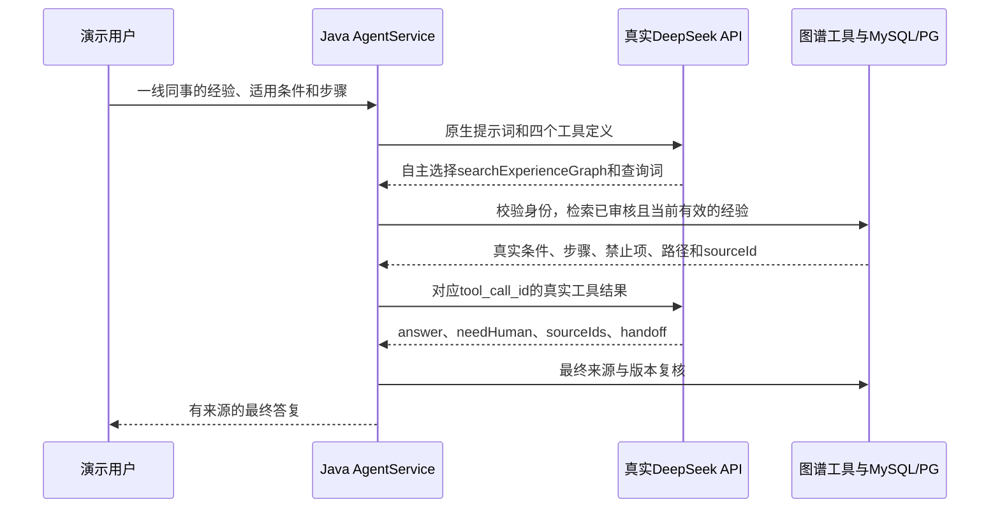

# 真实Agent图谱工具验证：结果与问题清单

日期：2026-10-28。维护副本：`D:\SmartTicket-AI\.workspaces\review`。

## 结论

**已证明当前项目可以由真实DeepSeek模型自主选择图谱工具，并完成读取真实经验到引用来源的完整Agent闭环。两道预定正例均完成。** 同时发现普通规则题的上下文预算、退款能力表述和撤回后重复追问的问题，因此不能说五个场景全部通过。

本次保留原生四个可用工具：getTicketDetail、getTicketLogs、searchKnowledge、searchExperienceGraph。系统提示词沿用现有JAR，用户问题不点名图谱/工具，不指定强制tool_choice。Java执行真实检索，模型收到与自身tool_call_id对应的真实结果；没有用预画结果替换实际调用。

具体工具参数、原生请求、模型响应和最终回答见[首轮原始记录](../docs/evaluation/20261028-agent-graph-initial-run.json)与[撤回补验记录](../docs/evaluation/20261028-agent-graph-withdrawal-run.json)。这条机制与[DeepSeek官方Tool Calls说明](https://api-docs.deepseek.com/guides/tool_calls/)一致；本次真实成功证据来自项目实测记录。

## 五个场景实际表现

| 场景 | 真实模型选择 | 实际结果 | 评价 |
|---|---|---|---|
| AG01 原号可收短信 | 图谱检索 | 2次模型调用、1次工具；SUCCEEDED，needHuman=false，引用当前经验 | 通过：前提、步骤、禁止情形和演示范围正确 |
| AG02 原号停用 | 图谱检索 | 2次模型调用、1次工具；SUCCEEDED，needHuman=false，引用当前经验 | 通过：正确区分两种前提，解释申诉流程不触发实际人工办理 |
| AG03 Outbox的SENT | 一次返回文本与图谱两个调用 | Java依次执行成功，但下一轮触发12000保守Token限制，STOPPED；模型未收到这轮工具结果 | 未完成：工程上下文预算问题，不能算作回答成功 |
| AG04 退款到账承诺 | 直接追问，未调用工具 | WAITING_INPUT，未承诺三点到账，也未强制转人工 | 部分通过：声称能按退款单号核实，超出当前工具能力 |
| AG05 撤回后重问 | 图谱检索 | 补验2次模型调用、1次工具；撤回源不再出现或引用，WAITING_INPUT | 撤回边界通过；回答部分通过，重复询问已明确条件且未用文本回退 |

AG01和AG02的真实答复正确保留“模拟平台规则，非本项目已实现能力”，没有声称已完成密码重置。AG02虽然解释人工申诉路径，仍标记ANSWERED/NONE/needHuman=false，符合只咨询流程的请求。

AG05清楚指出现有“旧号停用”经验与用户“原号可收短信”前提不符，没有强行套用；但用户已说明是演示账号且能收短信，重复确认这些信息无法弥补缺少匹配经验的问题。应尝试有效文本来源，或准确说明当前证据缺口。

## 首轮验收器问题与补验

首轮AG05第一轮请求与AG01同题，验收器把跨场景相同请求当成网络重放，在发给DeepSeek前拦截了它。已将去重身份改为“场景ID＋请求哈希”：同一场景仍禁止重放；撤回后的独立场景可以发起同题请求。新增回归测试，并修正“没有实际检索也被记成撤回源不可见”的空判断。

保留首轮失败记录，不把它改成通过。首轮原始JSON中AG05的旧withdrawn_source_absent=true是空判断，不能作为证据；正式结论使用补验的真实检索/回答。补验仅执行未实际外发成功的AG05，沿用同一次20次/¥0.5授权，首轮6次与补验2次一并计入；未重跑成功题，也未重试AG03来挑选好结果。

## 调用、费用与环境

- 首轮6次＋撤回补验2次＝新增8次真实DeepSeek调用；累计443→451，上限仍为本批授权的463。
- 本批保守计量约¥0.055017；累计保守上界约¥2.792486，累计¥10封顶保持不变。它采用峰值价格与预算换算因子，不是实际人民币账单。[官方价格核对](https://api-docs.deepseek.com/quick_start/pricing/)
- 原账本保留，未清零；剩余12次本批额度不自动消费。没有厂商嵌入调用，本地Ollama BGE-M3为1024维。
- 两次真实执行的随机工单、运行记录、专用消息命名空间及新建测试PG库均已清理；已有库和模型保留。
- Java实现/JAR保持不变：331单元、270集成的已验证产物；本次修改验收脚本，最终116项Python测试通过。

预算、哈希、逐条AI辅助评价与原始证据位置见[本轮正式汇总](../docs/evaluation/20261028-agent-graph-real-summary.json)。模型接口返回别名deepseek-flash，没有在实测中识别到更细的固定内部模型快照。

## 下一轮建议

1. **P1：整轮上下文预算。** 普通知识题优先一次检索；两种检索都发生时，共享上下文额度，去重并保留完整必要条件，给最终生成预留空间。不能只看某一个工具输出是否合格。本轮未提高4次/6次/12000/60秒限制。
2. **P1：澄清时的能力边界。** Agent只能按现有工具查项目工单，不能把“拿到退款单号”说成能查真实退款/银行状态。应说明实际可查信息和缺少的业务接口。
3. **P2：区分用户信息缺失与知识缺口。** 已知条件不重复问；匹配经验缺失时优先尝试仍有效的文本来源，再准确说明缺口。

以上三项作为本轮发现记录，**本次没有修改生产提示词或Java逻辑来掩盖结果**。两道正例闭环通过不代表所有任务都稳定，也不能把这五道已知材料的定向回归称为盲测、生产成功率或图谱优于文本的因果证明。语义评级由AI辅助完成，未冒充独立人类签署。
