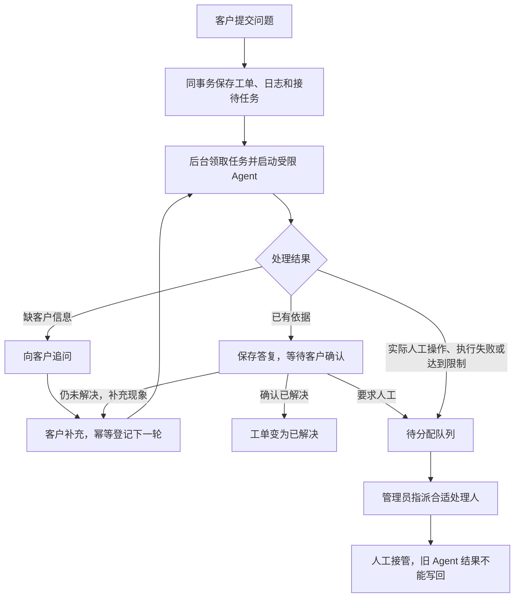

# 新工单由 Agent 优先接待：完成说明与启动指南

日期：2026-10-29。维护副本为 `D:\SmartTicket-AI\.workspaces\review`，原始根目录的 Java 代码不随本次维护副本更新。

## 现在怎样处理新工单

启用 reception profile 后：客户提交 → Java 校验并同事务保存工单与接待任务 → 创建成功立即返回 → 后台 Agent 查当前工单/知识/经验 → 回答、追问或进入人工待办。



简单答复、追问和客户确认都无需管理员逐条审核。管理员主要处理人工队列指派及已有共享知识审核职责。当前人工队列尚未增加排班/技能自动选择员工规则。

## 实际实现

- `ReceptionRepository`：新接待任务、工单级有限上下文、客户回应幂等、状态流转、租约与版本围栏。模型 I/O 在数据库事务外。
- `ReceptionWorker`：独立后台执行器，定时扫描不会被慢模型阻塞；崩溃后的过期租约可恢复，默认最多3次。
- `AgentService.runReception` / `AgentTools.executeReception`：复用真实工具循环，接待模式仅允许当前工单详情及共享知识/经验；不授权员工日志、指派或实际退款操作。管理员创建的工单也使用最低权限接待。
- `ReceptionController`：客户查看答复、补充信息、确认解决、请求人工；对象权限校验在服务端执行。
- `TicketServiceImpl`：创建时登记接待；人工修改、指派、解决和关闭时取消旧接待写回能力。启用接待时不重复创建后台分类任务。
- 新增 `ticket_reception` 和 `ticket_reception_message`。此链路直接领取同库持久任务执行，没有跨 MQ 的新发送动作，因此不新增 Outbox；旧分类分析与知识索引的 Outbox/RabbitMQ 仍然存在。

Agent 答复完成仅代表“已提出答复”，工单进入待反馈。只有原提交人确认才变为已解决；模型的一句“已经解决”不会替代确认。默认最多6轮，超限、模型不可用或缺实际执行工具时进入人工待办。系统内保存消息供客户端读取，没有接入短信或外部客服消息发送渠道。

## 已完成验收

| 层次 | 结果 |
|---|---|
| Java 单元测试 | 336项通过，0失败/错误/跳过 |
| Java 集成测试 | 300项通过，其中新增接待30项 |
| Python脚本保护检查 | 120项通过 |
| 实际 JAR/HTTP/后台调度/MySQL/工具协议 | 通过，8次本地模型协议请求，0次厂商调用 |
| 原有人工、Outbox、RAG、图谱回归 | 包含于完整回归，通过 |
| 开发数据库迁移 | 已新增两张表；原有工单与日志数量不变；历史工单不自动进入接待 |

交付 JAR SHA-256：`4eacb2a40d4150704a84dcc46dedbd930ae80e905b0f972f669251cd576e88a4`。

真实 JAR 验收包括：创建自动调度→查询真实工单→答复待确认→客户确认；追问→客户补充→下一轮；人工事项→交接摘要/工具轨迹→人工指派→禁止恢复自动接待。测试结束已停止自己的服务并清理自己的数据。

模型与召回使用本地确定性替身，证明工程闭环；本次没有进行真实 DeepSeek 生成质量复验，也没有花费既有批次的剩余额度。先前双检索预算、退款能力措辞、重复澄清等真实模型发现，不能据此宣称已全部解决。

完整回归还修正了一处原有图谱测试的随机性：测试条件中的 UUID 连续数字可能触发手机号脱敏规则，现将测试数字分隔；真实脱敏规则未放宽。

## 在本机使用

代码位于维护副本。基础 profile 保留旧流程，以兼容未迁移环境；**要采用新流程，启动时必须启用 reception profile 或加 `-AgentReception`。**

```powershell
Set-Location 'D:\SmartTicket-AI\.workspaces\review'

# 本机开发数据库已经迁移；此命令可幂等检查，不会回填旧工单。
py -3.11 '.\08_部署与环境\03_scripts\prepare-reception.py' --env-file 'D:\SmartTicket-AI\08_部署与环境\01_docker\.env'

# 维护副本的本地配置按原服务说明准备完成后，再用新开关启动。
& '.\06_项目源代码\ticket-service\start.ps1' -Mode real-model -EmbeddingProvider ollama -AgentReception -Offline
```

`-Offline` 只控制 Maven 离线依赖，不会阻止 DeepSeek 外部调用。真实模型密钥、预算和共享知识启用沿用原配置；未配置模型时创建仍能成功，接待进入人工待办。不要通过开启无限预算来替代模型或知识故障排查。

零厂商调用的完整自动演示可单独运行（使用已验证 JAR，自动启动并清理自己的演示环境）：

```powershell
py -3.11 '.\08_部署与环境\03_scripts\verify-agent-reception.py' --java 'D:\SmartTicket-AI\09_项目依赖与资源\02_下载链接与校验\安装包\JDK\jdk-17-runtime\jdk-17.0.20.1+1\bin\java.exe'
```

接口：`GET /api/tickets/{id}/reception` 查看接待；`POST /api/tickets/{id}/reception/responses` 提交 MESSAGE、RESOLVED 或 HUMAN。所有请求用项目 API Key；具体参数和状态见[完整契约](../docs/api/agent-reception.md)。

本次源码、构建证据及演示证据独立记录。远程CI以本次提交的 GitHub Actions 结果为准；[构建记录](../docs/evaluation/20261029-agent-reception-build.json)、[JAR演示结果](../docs/evaluation/20261029-agent-reception-http.json)。

10月28日学习材料与互动页面展示的是当时的默认流程。现在讲面试时需要补充：Agent优先接待是本次新增的显式启用流程，客户确认、人工接管、版本保护由 Java 后端负责。
