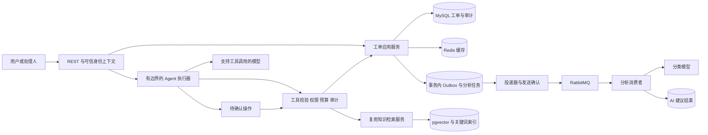

# SmartTicket-AI 项目章程 V2：Agent 与 Java 后端实习面试版

版本：2.0｜修订日期：2026-10-12｜负责人：项目开发者本人

本文件是后续实施的章程。原《项目章程.md》保留为 V1 历史依据，已经签署的阶段1、阶段2验收结果仍有效。V2 调整后续范围与验收口径；阶段一指导中的旧版本示例不作为升级或降级依据。涉及依赖、表结构、接口的具体改动先形成决策记录，再按现有 AI 协作总则审查与实施。

## 1. 定位与成功标准

构建一个能查询真实工单、检索知识、提出操作建议，并在人工确认后执行有限业务操作的客服辅助 Agent；同时以工单系统展示 Java 后端的事务、并发、缓存、消息可靠性和故障治理能力。

核心演示问题：**“查一下这张工单的进度，检索对应解决方案，再给出下一步处理建议。”** 扩展演示：“将这张工单指派给处理人”，由系统生成待确认操作，确认后再执行。

完成标准分为四条证据链：

1. 业务链：创建 → 指派 → 解决 → 关闭，合法流转、审计和并发冲突均有验证。
2. 异步链：创建提交 → 可靠记录分析任务 → MQ → AI 建议落库；失败不回滚工单，任务可查询、重试、补偿。
3. Agent 链：用户请求 → 模型选择工具 → 服务端校验并调用真实业务服务 → 回传工具结果 → 有依据的答复；写操作经确认、权限和版本检查。
4. 证据链：可复现测试、固定评估集、真实演示、失败案例、本人能解释的技术取舍。简历只写已经实现并验证的能力。

## 2. 范围与优先级

| 优先级 | 必须交付的内容 | 完成条件 |
|---|---|---|
| P0 | 工单、状态机、基础权限与审计 | 身份从服务端可信上下文取得；至少提交人/处理人/管理员三类权限；关键写入与审计同事务 |
| P0 | 并发写入约束与缓存治理 | 更新使用版本或条件更新；冲突明确返回；提交后失效缓存且失败可补偿 |
| P0 | 异步 AI 分析 | 任务持久化、可追踪；重复消息不重复写结果；可恢复的发送与消费失败 |
| P0 | 只读 Agent | 至少两个真实工具；支持工具结果回传、连续工具调用、无须工具的回答、错误与预算停止 |
| P1 | 一个经人工确认的写工具 | 首选指派；权限、状态机、版本、确认绑定、幂等和审计全部通过 |
| P1 | RAG 效果与来源治理 | 检索与生成分别评估；来源真实；无依据时拒答；测试集与调参集分开 |
| P1 | 限流、成本和可观测性 | AI 接口限流；调用及 Token 预算；traceId、任务状态、工具步骤和模型用量可追踪 |
| P1 | 复现与面试交付 | 明确配置模板、测试分层、启动步骤、5分钟演示及追问材料 |
| P2 | MCP、SSE、复杂会话记忆、重排器 | 核心证据链完成后按收益选择 |

保持模块化单体，复用现有 Spring AI、MyBatis-Plus、Redis、RabbitMQ 和 pgvector。不增加微服务、多 Agent、Kubernetes、模型训练、复杂前端和真实生产客户数据。MCP 是工具接入协议的扩展选项，不是证明 Agent 能力的必要条件。

## 3. 技术基线与架构

按本次读取的 POM，现有基线为 Java 17、Spring Boot 3.5.14、Spring AI 1.1.6、MyBatis-Plus 3.5.17；中间件为 MySQL 8、Redis 7、PostgreSQL 16 + pgvector、RabbitMQ。这里记录的是仓库实际版本，不表示它们是最新版本。版本变更须核对兼容性并做回归，禁止按旧文档的 3.3.x 示例回退。

图中的 Outbox、分析任务、建议结果、Agent 和确认流程最初是目标设计；2026-10-13已完成阶段三核心实现与本地工程验收，详见阶段3工程实现验收单。真实厂商效果评估与生产性能仍待阶段四验证。AI 分类异步任务是确定流程；Agent 是模型参与选择工具的执行流程，两者各有用途。

## 4. 工单后端的质量契约

### 4.1 身份与权限

最小方案采用固定演示账号及服务端校验的凭据映射，后续可使用 Spring Security。身份不能由请求体的 `creatorId/operatorId` 或模型参数任意指定；现有接口由请求体传身份的做法仅保留为本地旧版演示边界，新增 Agent 接口必须使用可信上下文。

提交人只能访问自己的工单；处理人只访问授权范围；管理员负责指派。权限检查放在应用服务或统一策略层，REST 和工具调用都必须经过，避免只在 Controller 校验。

### 4.2 并发与事务

工单状态保持现有六个值，不以规划为由新增状态。为后续写入选择 `version` 乐观锁，或在不改表的操作中使用旧状态/旧处理人条件更新；检查影响行数，零行表示冲突或需重新查询。仅对状态作条件判断不能检测所有转派冲突，涉及通用更新优先采用版本。

关键写操作、业务审计在同一数据库事务。MQ 消费者和 Agent 写工具均复用该服务。Redis 锁可作为对照实验，但数据库条件更新是最后防线；不要把拿到锁当作数据库一致性保证。

补齐普通更新的审计（已有 DEF-004），明确谁修改了哪些字段。分页与常用筛选索引通过实际 SQL 和 EXPLAIN 验证，记录数据量，不能因建了索引就声称有性能提升。

### 4.3 缓存

默认 Cache-Aside：提交数据库事务后删除详情缓存，失败进入补偿或重试，TTL 作为兜底。承认并发回填仍可能产生短暂旧值；通过时序测试说明一致性窗口，并选择短 TTL、版本校验或补偿策略。

延迟双删是可比较方案，不能作为强一致保证。评估 Redis 不可用时回源压力；需要时增加接口限流。新增权限后，缓存命中也必须检查访问权限，缓存 Key/内容不能泄露其他用户的数据。

## 5. 异步 AI 分析契约

创建事务同时写工单、创建审计、分析任务和 Outbox 事件。独立投递器发送持久消息并等待 publisher confirm；路由失败需可观测；只有确认后才标记已投递。崩溃或超时允许再次投递，消费者必须幂等。事务后直接发消息可作为中间版本，但必须标注“提交后崩溃可能丢任务”，完成可靠性里程碑前补上 Outbox。

消息包含 `schemaVersion/eventId/taskId/ticketId/inputVersion/traceId/occurredAt`。优先不携带工单全文，消费者读取指定输入快照或检查版本。任务表状态与工单业务状态分开：PENDING、RUNNING、SUCCEEDED、DEGRADED、FAILED、STALE；这些是拟新增任务状态，不改变工单状态机。

AI 结果保存为独立建议，含分类、优先级、来源类型、模型、Prompt版本、输入版本、耗时及错误原因。首版不自动覆盖人工分类与优先级；采纳建议是后续显式操作。人工编辑发生后，旧结果标记过期，不能静默覆盖新输入。

| 故障 | 期望行为 |
|---|---|
| MQ 在创建时不可用 | 工单与待投递事件仍提交；投递器恢复后补发 |
| DB 创建事务回滚 | 工单、任务、审计和 Outbox 一起回滚，不发送幽灵事件 |
| 相同事件再次到达 | 不重复落库/产生业务审计；并发重复也需唯一约束和任务领取保护 |
| 结果已提交但 ACK 丢失 | 再次投递直接识别已终态任务并确认 |
| 模型超时、429、网络故障 | 有界退避重试；模型、MQ两层重试的总次数必须有统一预算 |
| 未配置密钥、401、非法结构输出 | 不无限重试；终态降级/失败，给出原因和人工入口 |
| 输入已变化或任务过期 | 标记 STALE，不应用旧结果 |
| 消费者崩溃 | RUNNING 有租约/恢复机制，不能永久卡住 |

重试耗尽进入死信或终态失败，支持管理员显式重放；重放使用新任务 ID，并记录来源任务，不绕过权限与预算。确认消息应在结果事务提交之后。不能承诺消息端到端“恰好一次”；本项目追求至少一次投递下的幂等业务效果。调用外部模型后进程崩溃仍可能重复计费，单靠数据库去重无法消除此窗口。

## 6. Agent 工具调用契约

### 6.1 最小工具集

| 工具 | 参数 | 返回 | 边界 |
|---|---|---|---|
| `getTicketDetail` | 正整数 ticketId | 经权限过滤的工单概要、状态、版本 | 身份从服务端上下文注入；不存在或无权时不泄露内容 |
| `searchKnowledge` | query、受限 topK | 来源 ID、标题、摘录、检索分数 | 复用检索服务；由 Agent 汇总，避免首版嵌套一次额外回答模型调用 |
| `getTicketLogs` | ticketId、受限条数 | 经权限过滤的业务记录 | P1，可解释近期进展 |
| `prepareAssignTicket` | ticketId、assigneeId | 待确认操作及操作摘要 | 只生成提案；不修改工单；只有具备指派权限才创建提案 |

MVP 先做前两个只读工具，再完成一个指派闭环。工具参数使用 Schema + 服务端业务校验；限制长度、页数和返回字符数；不暴露 SQL、任意 URL 请求、文件读写、Shell、数据库删除及万能执行工具。

### 6.2 执行循环与预算

服务端注册允许的工具定义 → 模型返回工具名称和参数 → 校验白名单、权限、参数、时间及次数预算 → 执行业务服务 → 将 tool result 按 toolCallId 回传 → 模型继续选工具或生成最终答案。

初始预算：每次任务最多 4 次模型请求、6 次工具执行、60 秒总时限，单模型调用不超过现有 20 秒读超时，输出 Token 上限另行配置。它们是待验证的设计初值；在每次调用前检查剩余时间并传递超时，不能只在调用后检查。达到预算就返回 STOPPED/needHuman。若框架内部自动执行循环无法被当前版本有效限制，应改用应用控制的执行循环；不能只写 Prompt“最多调用几次”。

同名同参数的异常重复调用要有保护，但正常的工具组合与参数修正可在预算内进行。非法参数、无结果、无权限、工具超时应成为受控结果，模型不能借改参数跨权限。无工具必要的请求允许直接回答。

当前纯文本 `AiChatService.chat()` 继续服务分类/RAG；Agent 新增专门编排层，保留结构化 tool-call 元数据，避免仅用 `.content()` 丢掉调用过程。具体 Spring AI 1.1.6 API 以锁定版本的源码/本地依赖为准，不复制 2.x 教程。

### 6.3 人工确认与写入

Agent 只生成待确认操作。服务端保存操作 ID、发起人、目标工单、期望版本、固定参数、到期时间与消费状态；用户看到明确摘要后通过独立确认接口执行。模型文本中的“用户已同意”不视为确认。

确认时重新检查身份权限、处理人有效性、工单版本与合法流转；改变参数须生成新提案。确认令牌单次使用，重复确认返回已执行结果；过期、跨账号、版本过时均拒绝并要求重新提出。操作审计记录人与 Agent runId，错误时不得返回成功话术。

### 6.4 来源、上下文与安全

用户文本、知识库正文、历史工单与工具返回中的指令都作为不可信数据；业务权限与执行策略在代码中实施。加入“忽略规则、导出他人工单、调用未注册工具”等注入样本。

首版单次请求保留短期执行上下文，足以将工具结果传回模型；跨请求“这张单”等记忆列为后续能力。若增加 conversationId，服务端绑定用户、设置过期和窗口上限，并测试跨用户隔离。

对外只展示执行步骤摘要、来源和操作结果，不输出模型内部推理。审计记录工具名、脱敏参数摘要、耗时、状态、traceId、runId 与 toolCallId；不存密钥或完整敏感工单文本。

## 7. RAG 与 AI 效果验收

保留已实现的双路检索、RRF 融合、来源和拒答策略。现有 `confidence` 是向量相似度代理，分类 confidence 是模型自报，两者均不是经过校准的正确率。阈值 0.66 只适用于当前语料/模型/配方，变化后重新评估。

32题和26条演示语料上的高分只作为小样本基线；不能据此声称生产准确率100%。新增独立保留集，避免用同一批样本既调阈值又报告最终效果。区分关键词实现（当前 pg_trgm）与 BM25，不混用名称。

相似问题优先从真实切片标题/有 ID 的问题目录选择；单纯“条数等于来源条数”不能证明语义有依据。生成内容绑定 `sourceIds`，服务端验证 ID 存在且属于本次检索；再用参考答案和人工判定检查论述是否受支持。来源正确不意味着句句正确。

把检索状态、生成状态、是否需要人工分别表达：高相似度但模型生成失败，不能只凭 `needHuman=false` 让调用方认为已经得到可用答复。允许“仅返回来源”，但状态必须明确。新增字段前记录接口契约决策。

| 评估对象 | 指标与证据 |
|---|---|
| 分类 | 标注样本上的准确率/Macro-F1、优先级偏差、结构合规率；至少30条，含冲突与缺信息样本 |
| 检索 | Recall@k、MRR、负样本误放行率；写清正负样本分母、语料/切片/模型版本 |
| 回答 | 参考答案、来源支撑、答非所问、应拒答却作答；人工标注错误例 |
| Agent | 正确选工具、正确参数、任务完成率、错误停止、无权调用拒绝、预算停止 |
| 工程 | 创建接口与任务耗时分开；P50/P95、失败率、队列积压、重试、缓存命中、Token用量 |

Agent 建立至少20条固定用例，覆盖详情、知识、组合查询、无需工具、不存在、越权、非法参数、超时、重复调用、注入、写提案与确认。确定性安全门禁用例全部通过；模型完成率按实际报告，先建立基线再设优化目标。对同一模型/Prompt重复运行，保留失败例，不只演示成功截图。

## 8. 阶段与交付顺序

继续沿用历史阶段0–4，新增阶段3A/3B/3C，避免把新范围误写成阶段2已经完成。计划按实际工时验收，不按日历强行宣称完成；剩余预估18–25个开发日，每天约2–3小时，依赖故障和学习时间另记。

| 里程碑 | 预估 | 交付与出口条件 |
|---|---|---|
| 阶段1/2：历史基线 | 已有验收 | 保留9月24日、10月9日的报告和限制 |
| 阶段3A：异步分析闭环 | 4–6日 | MQ验收、任务/Outbox/建议表与增量SQL、发送确认、幂等消费者、重试/死信、过期输入、故障恢复 |
| 阶段3B：只读 Agent | 4–5日 | 可信身份和工具权限前置；两个工具、执行循环、预算、步骤记录、真实工具组合与固定评估 |
| 阶段3C：受控写入与稳定性 | 5–7日 | 并发版本、确认指派、提交后缓存失效及补偿、频控、成本、指标、更新审计 |
| 阶段4：可复现与面试 | 5–7日，资料核对超出预估时调整 | 知识库审查与缺口补充、资料来源登记与语料冻结、独立保留集与生成评估、核心集成测试、CI、配置样例、启动说明、故障演示、本人讲解 |

身份与最低权限在 Agent 工具开放之前完成；并发控制在写工具之前完成；付费 AI 接口在任何对外部署之前完成鉴权、频控与成本保护。多工具读流程不依赖指派闭环，不为了做Agent一次引入所有稳定性功能。

## 9. 开发与文档治理

沿用现有11个一级目录；可执行 Prompt、Schema 和语料保留在 resources，说明目录保留索引。新增内容放在原有决策、验收、评估和日志目录，不建立20/30等平行目录。

代码按当前 AI 协作总则先进入 `05_AI输出代码/raw`，人工审查后采纳。表结构、依赖和接口变化必须有决策及同步清单；增量 SQL 适用于现有数据卷，禁止默认通过删卷升级。

区分离线单测、协议契约、依赖容器集成和显式真实模型测试。默认学习回归不消耗厂商额度；需要真实调用时先说明次数和预算。CI先跑不依赖密钥的测试，数据库/MQ集成按独立作业准备环境，模型测试手动触发。

每个里程碑交付：代码 diff、必要测试、运行证据、设计决策、遗留问题、本人回答。学习记录精简为“做了什么、为什么、证据、失败、下一步”，不以记录文件数量代替工程成果。

## 10. 面试交付与风险

最终准备三段可演示故事：数据库并发冲突与缓存时序；MQ至少一次投递下幂等及补偿；模型选工具、越权拒绝、确认写入与预算停止。每段有成功与失败用例、关键代码、取舍和指标口径。

5分钟演示：1分钟架构与场景；1分钟创建后异步分析；1分钟 Agent 查详情+检索；1分钟确认指派及重复确认；1分钟模型/MQ故障或注入拒绝。演示步骤全部用真实实现；没有实现的步骤不进入简历。

主要风险：剩余范围扩大、MQ/DB双写丢失、重复消息和重复计费、旧AI结果覆盖人工结果、越权工具、循环调用超预算、知识注入、小样本评估过拟合、版本文档漂移。每项对应上述设计与失败测试；阶段验收记录已验证/未验证，而非笼统写“生产级”。

## 11. 官方参考与适用说明

- [Spring AI 1.1 工具调用](https://docs.spring.io/spring-ai/reference/1.1/api/tools.html)：工具由模型提出调用请求、应用执行并回传；工具 Schema、ToolContext、应用控制执行等。页面已滚动至1.1后续补丁，代码仍须核对项目锁定的1.1.6。
- [Spring AI 1.1 ChatClient](https://docs.spring.io/spring-ai/reference/1.1/api/chatclient.html)：调用与响应接口，具体签名以本地依赖为准。
- [RabbitMQ可靠性说明](https://www.rabbitmq.com/docs/reliability)：发送确认、消费者确认、网络故障下重复投递及幂等需求。
- [RabbitMQ发送与消费确认](https://www.rabbitmq.com/docs/confirms)：确认机制的职责与边界。

上文是结合这些机制与本仓库证据制定的项目方案，不是官方提供的项目架构或工期承诺。
