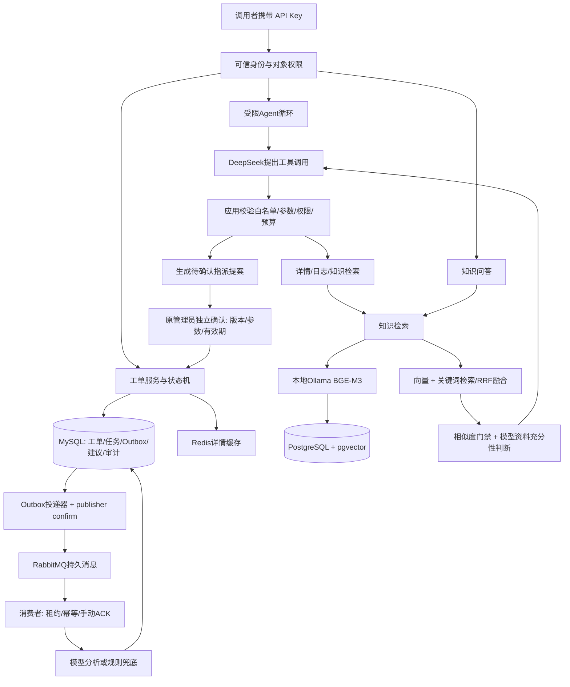

# SmartTicket-AI 当前架构与边界

更新：2026-10-15。实现形式是模块化单体；下面的组件是职责划分，不是微服务。

## 五个设计理由

1. RabbitMQ负责传递任务，任务表负责业务处理状态；二者不是重复造轮子。
2. 工单、任务和Outbox同事务保存，避免工单成功但待分析消息丢失。发送确认并不等于消费者处理成功。
3. 建议独立保存，输入版本过时标STALE，不自动覆盖人工分类或优先级。
4. 模型只提出tool call，应用执行真实工具；指派提案不能执行写入，必须独立确认。模型口头“用户已确认”无效。
5. 向量模型找资料，DeepSeek读资料并生成回答。BGE-M3在本机运行，知识查询嵌入没有厂商按次费用；对话仍计费。

## 当前边界

- API Key演示身份不是完整注册登录/SSO平台。
- 账户、短信、支付、附件等资料是模拟客服场景，不代表项目实现了这些业务。
- 高相似度不等于资料覆盖问题；RAG v3允许追加拒答。相似度不是正确概率。
- Agent的SUCCEEDED表示受限循环正常结束，不等于业务目标语义上完全完成，必须结合回答、工具参数和来源审查。
- 保守预算按字节和协议余量预留，不是厂商账单；幂等防止重复落库，不保证外部模型绝不会重复计费。
- Redis读取还会核对MySQL版本，增加一次数据库访问；未证明高并发性能提升。
- 当前有本地测试与小样本评估，未远程运行CI，不能称生产系统或通用Agent基准。

主源码：ticket-service下TicketServiceImpl、Phase3Repository、AsyncAnalysisWorker、AgentService、AgentTools、AgentToolContext、RagAnswerServiceImpl。完整实测见07_测试与质量/06_阶段测试报告。
