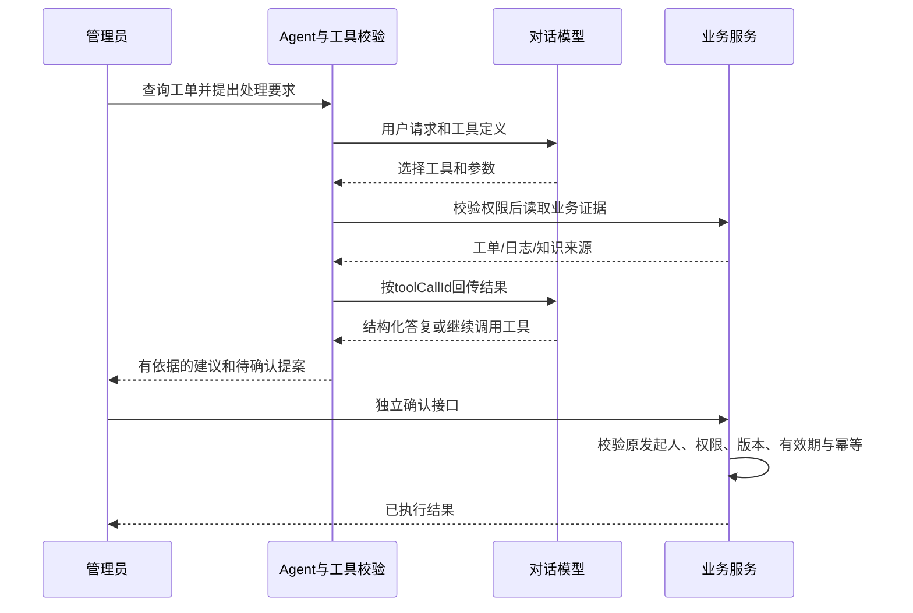
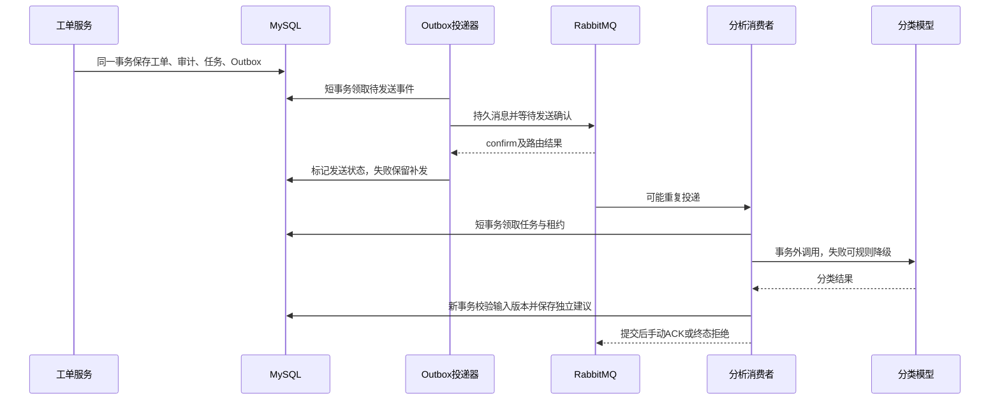

# SmartTicket-AI

用于 Java 后端与 Agent 实习面试的模块化单体：工单业务、可靠异步 AI 分析、本地 RAG 和受限工具调用。

**快速导航：** [后端源码](06_项目源代码/ticket-service/src/main/java/com/smartticket) · [启动与配置](06_项目源代码/ticket-service/README.md) · [架构与设计](docs/architecture/README.md) · [接口与角色](07_测试与质量/02_接口测试/阶段四_角色矩阵与接口说明.md) · [测试与效果边界](docs/evaluation/README.md)

当前保留原工程路径以兼容启动、评测和部署脚本；日常阅读从本页与 [docs 导航](docs/README.md)开始。过程记录按日期保留，作为协作与失败追踪资料。

当前状态（2026-10-20）：第一轮工程整改已验收并合入 main，R05动态知识的本地与远程CI均通过；`codex/quality-closure` 继续推进R06。新增新措辞检索实测、版本绑定复核工具和四链演示指南；作者已复核1/148，整体质量签署仍待完成。见[R06进展](docs/evaluation/20261020-quality-closure.md)。

第一轮完成职责拆包、持久化分离、错误契约统一和预算死锁修复，见[工程验收](docs/evaluation/20261019-engineering-review.md)。本批动态知识增加结构化解决记录、人工审核、可靠增量索引和撤回；252 单元 + 171 集成 + 22 Python 通过，实际 JAR/HTTP/RabbitMQ/本地 BGE-M3 闭环通过，见[动态知识验收](docs/evaluation/20261019-dynamic-knowledge.md)与[操作指南](docs/api/dynamic-knowledge.md)。下方 234/137 数字是首次公开基线。

- 工单：状态机、可信身份与对象权限、事务审计、版本冲突、缓存失效与补偿。
- 异步：任务表与事务Outbox、RabbitMQ确认、幂等消费、租约恢复、规则兜底与人工重放。
- Agent：真实业务读工具、知识检索、受约束循环；指派仅生成提案，须原管理员独立确认。
- RAG：本地Ollama BGE-M3 1024维、向量与关键词融合、0.63生成门槛、来源与模拟范围、失败原因。
- 知识回流：解决说明生成候选，管理员审核后发布共享演示知识；双库版本校验、失败重放审计及撤回。默认关闭，需迁移与显式启用。

当前最终源码Linux空Maven缓存234单元＋137集成通过，Python保护测试22项；最终JAR真实启动、接口15请求35断言和本地RAG检查通过。NW13最终版一次真实复验已恢复回答，不据此宣称总体准确率或模型绝不出错。

## 使用入口

首次克隆后需要 Java 17、Maven 和 Docker。下面的测试不调用厂商模型：

```bash
python "08_部署与环境/03_scripts/verify-test-profiles.py"
mvn -B -f "06_项目源代码/ticket-service/pom.xml" -Punit test
python "08_部署与环境/03_scripts/prepare-phase4.py"
```

最后一条准备隔离中间件、随机凭据及 `.tmp/phase4-integration.properties`。随后从 `06_项目源代码/ticket-service` 运行：

```bash
mvn -B -Pintegration -Dspring.config.additional-location=file:../../.tmp/phase4-integration.properties test
```

已有隔离卷时保留对应 `.tmp/phase4.env`，不要重新生成密码后复用旧卷。配置模板与本机演示启动见服务 README。

已有本机配置时，从项目根目录运行：

```powershell
& '.\06_项目源代码\ticket-service\start.ps1' -CheckOnly
& '.\06_项目源代码\ticket-service\start.ps1' -Mode offline-demo -Offline
```

首次环境准备、完整测试与配置要求见[服务README](06_项目源代码/ticket-service/README.md)。本地检索不等于真实模型生成；真实调用采用已验证交付JAR及计量代理，累计400次已用满，没有新授权不继续调用。

## Agent 如何使用工具

| 工具 | 行为 | 执行边界 |
|---|---|---|
| getTicketDetail | 查真实工单详情和版本 | 服务端身份、对象权限 |
| getTicketLogs | 查处理进展 | 服务端身份、对象权限、条数限制 |
| searchKnowledge | 查知识来源和摘录 | 有限参数和输出，不嵌套一次额外生成 |
| prepareAssignTicket | 生成待确认指派提案 | 管理员可用，模型不能确认执行 |



模型和工具执行有次数、Token、时限与线程池边界。跨请求会话记忆尚未实现；当前循环可在一次请求内连续调用多个工具。

## 异步分析如何恢复



任务幂等和租约约束重复业务效果，不保证外部模型恰好计费一次。业务重试有限；基础设施异常会暂停消费并尝试恢复。

## 当前事实与文档

- [当前项目状态](01_项目说明/20261019_项目状态与未结问题.md)
- [专家评价核查与修改执行计划](01_项目说明/20261019_专家评价核查与修改执行计划.md)
- [项目章程](01_项目说明/项目章程_v2_Agent与后端实习面试版.md)
- [阶段四验收清单](01_项目说明/07_阶段验收单/阶段4_验收清单_待执行.md)
- [最新收尾验收与原始证据](07_测试与质量/06_阶段测试报告/20261019_项目收尾验收记录.md)
- [角色、接口及版本契约](07_测试与质量/02_接口测试/阶段四_角色矩阵与接口说明.md)
- [架构与设计边界](10_面试与复盘/01_架构与设计/阶段四_架构与边界.md)

短信、支付、附件等知识是模拟客服场景，不代表项目实现了这些业务。固定演示API Key不是完整用户注册/SSO。已知题放行率不等于答案准确率；148条作者语义复核、长期稳定性与生产容量仍未签署或证明。远程CI证据见[首次执行结果](https://github.com/hashishdhdj/smartticket_AI/actions/runs/39204570840)。MCP、SSE、复杂记忆、复杂前端不是当前章程必交范围。

私有本机配置与运行凭据位于被忽略的本地文件；只使用08_部署与环境/04_交付产物下已验收公开JAR分发，不分发源码target中的中间包。评审后修改按执行计划分批推进，新增功能验收后再更新完成状态。
